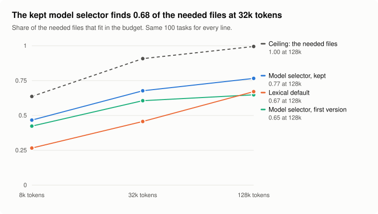
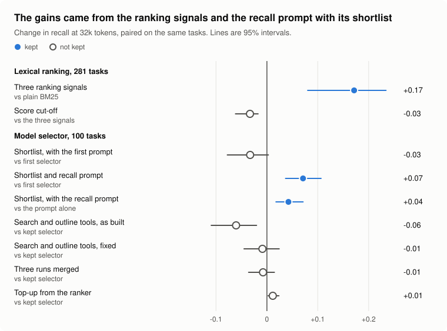

# Choosing what a model reads from a repository

*What fits in 8,000, 32,000 or 128,000 tokens, and how to choose it. A lab report on
Repo2Txt's `select`, 14–15 November 2026.*

## Summary

- **The question.** Given an issue and a repository, which files should a model be handed,
  and how much of what it needs fits in a fixed budget? Measured on 281 real issues from 40
  open-source repositories, each with the files a person judged necessary to resolve it.
- **Lexical ranking, nearly doubled.** Plain BM25 finds 0.29 of the needed files at 32k
  tokens. Three cheap signals take it to 0.47: a file the issue names comes first, a file that
  defines a named identifier is lifted, and tests and prose rank below code.
- **A small model, choosing well once told why.** Claude Haiku 5.5 choosing from the tree
  found 0.61 at 32k. Told that a missed file costs more than an extra one, and shown the
  ranker's top 30, it finds 0.68, and 0.77 at 128k. Search tools, merged runs and padding
  from the ranker added nothing.
- **Not yet a result.** These are the tasks the methods were tuned on. A further 219 tasks
  from 19 other repositories are held out and have not been run.

<picture>
  <source media="(prefers-color-scheme: dark)" srcset="img/recall-by-budget-dark.svg">
  
</picture>

## What is measured

A method is given an issue's text and the repository at the issue's commit, and returns files
in order of preference. The harness keeps them, in that order, while they fit the budget.

**Recall** is the share of the needed files that were kept. If a task needs four files and a
method's selection holds three of them within 32,000 tokens, its recall at 32k is 0.75.

Recall alone is easy to game: return everything, and a large enough budget scores 1.0. So
**precision** is reported beside it: the share of the kept files that were needed. A method
that fills 32,000 tokens with fifty files to catch the three that matter scores well on recall
and 0.06 on precision.

**The ceiling** is the needed files themselves, smallest first. It is below 1.0 whenever they
do not fit, and it is the dashed line in the chart above.

The tasks come from [ContextBench](https://arxiv.org/abs/2602.05892) (Li et al., February
2026): real issues with the lines of code annotators judged necessary. The fix and its tests
are never shown to a method. Tasks are split by repository, so that tuning cannot learn a
codebase it is later scored on, and the held-out split cannot be run without an explicit flag.
The median repository has 1,909 readable files and 1.8 million tokens; a task needs two files
at the median and three on average.

Intervals are 95%, from resampling whole repositories, because tasks from one repository are
not independent. Comparisons between methods are paired on the same tasks.

## Lexical ranking: three signals a word count misses

BM25 scores a file by the words it shares with the issue. Issues are not written like search
queries, though. They name files outright, they quote identifiers in backticks, and they
describe behaviour that tests and documentation also describe. So three signals were added:

1. A file whose path the issue names is placed first.
2. A file that defines an identifier the issue names (`def`, `class`, `function` and their
   equivalents) is lifted above files that only use it.
3. Tests, examples and prose are ranked below code.

| Recall, 281 tasks | 8k | 32k | 128k |
|---|---|---|---|
| Smallest files first | 0.01 | 0.03 | 0.13 |
| BM25 | 0.15 | 0.29 | 0.47 |
| BM25 with the three signals | **0.28** | **0.47** | **0.67** |
| Ceiling | 0.60 | 0.92 | 1.00 |

At 32k the signals add 0.17 (interval 0.08 to 0.23): better on 95 tasks, worse on 14. They cost
nothing at run time. This is now the default for `select`.

The weakness is precision. The ranker fills whatever budget it is given, and about nine files
in ten that it returns are not needed. A cut-off that dropped files scoring under a quarter of
the best score raised precision from 0.10 to 0.17, and lowered recall on 22 tasks while raising
it on none. It was removed.

## The model selector: why it stopped at three files

The first model selector showed Claude Haiku 5.5 the directory tree with token counts,
collapsed to about 6,000 tokens, and gave it three tools: replace the selection, adjust it,
and open a collapsed directory. On 100 of the tasks it beat the ranker at small budgets and
only matched it at 128k: 0.65 against 0.67.

The two reached the same recall at 128k by opposite routes. The model named a short, accurate
list and stopped at about 25,000 tokens, whatever the budget; half of what it chose was
needed. The ranker delivered 127,000 tokens, of which one file in thirteen was needed.

Before changing anything, the 233 needed files it missed at 32k were examined.

- **It chose too little.** A median of three files, using 14,000 of 32,000 tokens.
- **Seeing a file did not help much.** It found 43% of the needed files that were shown in its
  tree, and 39% of those hidden in collapsed directories.
- **The ranker already knew a third of the answer.** 33% of the missed files were in the
  ranker's top 30, and 56% in its top 100. The model never saw that ranking.
- **Size and tests mattered little.** 7% of misses were too large for the budget; 9% were tests.

One task shows the pattern. An issue in LangChain asks for language models to accept a local
cache when constructed. The first selector chose four plausible files from the
`language_models` directory and the cache module, and stopped. The file holding the global
cache setting, `langchain_core/globals.py`, sits elsewhere in a 6,737-file repository; the
ranker placed it 25th. The kept selector, shown that list, took it, along with the cache test
the fix would extend:

| | First selector | Kept selector |
|---|---|---|
| `language_models/llms.py` | chosen | chosen |
| `language_models/base.py` | chosen | chosen |
| `language_models/chat_models.py` | chosen | chosen |
| `caches.py` | chosen | chosen |
| `globals.py` (needed) | not chosen | chosen |
| `tests/.../chat_models/test_cache.py` (needed) | not chosen | chosen |
| four further tests and fakes | | chosen |
| Needed files found | 2 of 4 | 4 of 4 |

## Four changes, measured one at a time

Each was a switch, tried at 32k on the same 100 tasks.

<picture>
  <source media="(prefers-color-scheme: dark)" srcset="img/what-each-change-did-dark.svg">
  
</picture>

**A prompt that says why.** The rewritten prompt puts the tree first and the request last, as
Anthropic's guidance for long inputs recommends. It tells the model that whoever reads the
selection works from those files alone, so a file they need and were not given stops them,
while a file they did not need costs only its tokens. It says what to add after the obvious
files, asks the model to use most of the budget, and the harness reports tokens used and left
after every tool call, as [Context-1](https://www.trychroma.com/research/context-1)'s harness
does. With the shortlist of 30 ranked files beside the request, recall rose by 0.07 (0.04 to
0.11), better on 28 tasks and worse on 2. The median selection doubled to six files.
Precision fell from 0.50 to 0.33: the price of asking for thoroughness, accepted on purpose.

No published prompt that was read states the cost of a missed file against an extra one, so
that sentence is this project's own. Context-1 encodes the same preference in its training
reward, weighting recall sixteen times over precision at first.

**The shortlist only helps once the model is asked to be thorough.** Added to the first
prompt, it changed nothing (−0.03, interval −0.08 to 0.00). Taken out of the kept prompt, it
costs 0.04 (0.02 to 0.07), worse on 18 tasks and better on 4. Agentless found the same
combination worth having: 78.7% for a model choosing from the tree, 81.7% with retrieval
beside it ([Xia et al.](https://arxiv.org/abs/2407.01489)).

**Search and outline tools: a harness that failed, then a tie.** The trained code-search
agents published this year all work with search and read tools, so two were added: a
pattern search over file contents, and an outline of what a file defines. Recall fell by 0.06.

Ten of the tasks where it fell were rerun with the same configuration and their transcripts
read. This one, from jackson-databind, needed four files. Condensed, with patterns shortened:

```text
round 1  search '_anySetterField|…' in the repository           5 files
         search '_addFields|…' in introspect/                      1 file
round 2  search '_anySetter…' in POJOPropertiesCollector.java      no match
         search 'findAnySetterAccessor' in BasicBeanDescription.java   no match
round 3  outline POJOPropertiesCollector.java, BasicBeanDescription.java
         search 'AnySetter' in BeanDeserializerFactory.java        no match
round 4  search '…AnySetter' in databind/                          9 files
         search 'anySetter|AnySetter' in deser/                    11 files
round 5  search '_resolveAnySetter' in BeanDeserializerFactory.java    no match
         search 'AnySetter' in BasicDeserializerFactory.java       no match
round 6  reply in words; nothing selected
```

Every "no match" was reported without the file being read. The search tool treated a file
path as a directory and looked inside it for files. The files do contain what the model was
looking for (`BeanDeserializerFactory.java` mentions `AnySetter` nine times), and three of them
are needed files. The model, told nothing had matched,
kept searching until its five rounds ran out, and returned an empty selection.

Two faults, both the harness's. The broken file search wasted a round in five of the ten
transcripts. And nothing stopped exploration from using the rounds needed to select: in four
of the ten the model never selected anything. With the search fixed, a first selection asked
for before any checking, and the last round kept for selecting, recall recovered by 0.05 and
then tied the kept selector (−0.01, interval −0.05 to +0.02) at one and a half times the cost.

Had the transcripts not been read, this would have been recorded as "tools do not help". The
finding is narrower: under a five-round limit, search and outline tools tie a good shortlist,
probably because the shortlist has already done a search's work before the model starts. They
were removed.

**Three runs, merged.** Context-1 reports large gains from fusing four runs. Here three runs,
merged by votes, changed recall by −0.01 at three times the cost. A single run already uses
about 22,000 of 32,000 tokens, so most of what a second and third add does not fit.

**Topping up from the ranker.** Filling the budget the model leaves unused with ranked files
was the best method with the first selector: 0.74 at 128k against 0.65. With the kept selector
it adds 0.03 at 128k, halves precision from 0.27 to 0.14 and doubles the tokens delivered. It
was removed.

## Where it stands

| 100 tasks, recall (precision) | 8k | 32k | 128k |
|---|---|---|---|
| Lexical default | 0.27 (0.12) | 0.46 (0.12) | 0.67 (0.08) |
| First model selector | 0.42 (0.47) | 0.61 (0.50) | 0.65 (0.49) |
| Kept model selector | **0.47** (0.38) | **0.68** (0.33) | **0.77** (0.27) |
| Ceiling | 0.64 | 0.91 | 1.00 |

Against the first selector the kept one adds 0.04 at 8k, 0.07 at 32k and 0.12 at 128k (0.08 to
0.16), where it is better on 34 tasks and worse on 1. At 128k it now selects about 49,000
tokens. A selection takes about 24,000 input and 1,300 output tokens and six seconds. At an
assumed $1 per million input and $5 per million output tokens that is about three cents; the
model's actual price was not confirmed.

**At 8k the limit is file size, not choice.** Even the needed files themselves reach only 0.64,
because they often do not fit whole. No ranking closes that gap. The dataset marks the needed
lines, and line recall is already computed, so the next experiment is to return outlines and
line ranges and score them at line level. At 32k and above the limit is choice: 0.68 against a
ceiling of 0.91.

## What could overturn this

- **The held-out tasks.** Every number here is from the tasks the methods were tuned on. The
  219 held-out tasks come from 19 repositories the tuning never saw, and the numbers will be
  lower there. How much lower is the result that matters.
- **Python.** Half the tuning tasks are Python, and the ranker's recall at 32k is 0.55 on them
  against 0.32 to 0.43 on the other languages. The definition signal recognises a fixed list of
  keywords; it may be fitted to Python. This has not been separated out.
- **One run per configuration.** How much the model's selections vary from run to run was not
  measured. The paired intervals cover the variation across tasks, not across runs.
- **One model.** Whether a stronger model selects better, or whether what it is shown is the
  limit, was not tested.
- **Memory of the fix.** Whether the model had seen these repositories and their fixes in
  training was not measured. The lexical rows are unaffected; the model rows could be.

Two further limits change what the numbers mean rather than whether they hold. The needed
files are sufficient, not minimal, so precision is understated. And file-level recall treats a
30,000-token file and a 300-token file alike; line recall is in the results files but was not
used to choose between variants.

A June 2026 [study](https://arxiv.org/abs/2606.11976) of a small model on this task found that
pushing it to select more added files from unrelated areas. The fall in precision here is
consistent with that.

## Notes from building it

An independent review of the rebuilt code, by a reviewer who had not seen its design, found
eight defects its 35 tests had missed. `select` and `pack` counted a file's cost differently,
so a selection did not pack within the budget it was chosen for. git was run in untrusted
directories without disabling `core.fsmonitor`, which let a repository's own configuration
start a program. And an unchecked `--ref` could redirect a GitHub request with the user's token
attached. Each now has a test.

The dataset needed checking before it could be trusted. Some needed paths were recorded as
they appeared inside the annotator's container, some repository names were not the ones GitHub
knows, and four tasks listed scripts that were never in the repository. Three of the first
twenty tasks failed to load for these reasons, none of which had anything to do with the
methods.

## Reproducing

```bash
uv sync --all-extras
export GITHUB_TOKEN=...      # archive downloads are rate-limited without one
python -m bench.run --tasks 300 --methods smallest,bm25-plain,bm25,oracle --out bench/results/free.jsonl
export LLM_MODEL=claude-haiku-5-5 LLM_API_KEY=... LLM_BASE_URL=https://api.anthropic.com/v1/
python -m bench.run --tasks 100 --methods llm --out bench/results/llm.jsonl
python -m bench.report bench/results/free.jsonl
python -m bench.charts       # redraws the figures from bench/results/
```

The variants that were removed are not in the code at this commit. Their results are in
`bench/results/`, each described in `bench/results/README.md`, and the code that produced them
is in commits `f73bb00` and `ff7db64`.

## Sources

- Li et al., [ContextBench](https://arxiv.org/abs/2602.05892), February 2026.
- Xia et al., [Agentless: Demystifying LLM-based Software Engineering Agents](https://arxiv.org/abs/2407.01489), 2024.
- Chroma, [Context-1: Training a Self-Editing Search Agent](https://www.trychroma.com/research/context-1), 26 March 2026.
- Cognition, [SWE-grep](https://cognition.ai/blog/swe-grep), October 2025.
- Anthropic, prompting guidance for Claude Haiku 5.5, and [Writing effective tools for agents](https://www.anthropic.com/engineering/writing-tools-for-agents), September 2025.
- A study of repository localisation with a small model, [arXiv 2606.11976](https://arxiv.org/abs/2606.11976), June 2026.
